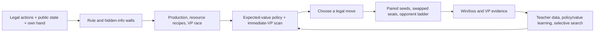

# 1v1 Catan agent: strategy and improvement plan

**Objective:** maximize the probability of winning the game. Victory points are the terminal objective and a useful progress signal; resource totals and attractive board shapes are valuable only when they improve our chance to reach the target first.

## Working rules contract

This folder targets a local two-player Catanatron game, provisionally using the base game, 10 victory points, a 7-card discard limit, official number placement, and the normal robber. The event interface and complete rules are not confirmed. The target and rules live in `configs/default.json`; change them only after comparing the event contract with this local preset. Results under this preset will not establish tournament strength under different rules.

The simulator provides legal actions, public board/buildings/scores, our private hand and development cards, and hidden opponent hands/deck contents in its internal `Game` object. The policy may use only its legal observation: legal actions, public state, and our own private data. In particular, the opponent's total resource-card count is public; the identities of those cards are not. The policy never reads the simulator's next dice roll, hidden deck order, or opponent card identities.

## Strategic framework

### 1. Hard walls

Every move must be legal and respect the engine's piece counts, settlement distance rule, road connectivity, building costs, and turn prompts. Those are enforced by the engine's legal-action list. The policy only returns one of those actions. It also respects the information boundary above and uses deterministic tie-breaking so a game can be replayed from a seed.

### 2. Economy and resource access

For every reachable build or development-card purchase, evaluate both the immediate cost and how often the resulting board is expected to produce. A tile's first-order production estimate is its dice probability, `(6 - abs(7 - number)) / 36`, multiplied by settlement/city yield. Resource values rise when that resource is scarce in our production or hand and when it completes a useful recipe.

The main recipes are:

| Goal | Cost | VP / strategic payoff |
| --- | --- | --- |
| Settlement | wood, brick, sheep, wheat | 1 VP, a new production site, and a new road frontier |
| City | 2 wheat, 3 ore | 1 additional VP and doubles that site's production |
| Development card | sheep, wheat, ore | Unknown card: possible VP, Knight/army progress, or a resource/road effect |
| Longest Road | roads | 2 VP at a road length of at least 5, if it exceeds the current record; vulnerable to a longer road |
| Largest Army | played Knights | 2 VP at 3 played Knights, if it exceeds the current army; Knights also move the robber |

The agent should avoid collecting a resource just because it has high standalone value. It should value the card in context: can it finish a settlement, city, or card purchase, and does that route lead to a faster VP? Ports and maritime trade are resource conversion tools when direct player trading is unavailable or unattractive.

### 3. VP race

Rank actions by a win-oriented state value: terminal win first, immediate VP and public score race next, then production, expansion reach, hand readiness, and army/road potential. Near the finish, stop paying for economy that cannot mature before an opponent's likely win. Check known same-turn combinations for an immediate finish before trusting a long-horizon heuristic. Hidden VP cards are unknown to the opponent and are never inspected by the policy; our own hidden VP cards are part of our information.

### 4. Deny the opponent

In a two-player game every denial action has one target. The robber scorer weighs the opponent's blocked expected production against our own lost production, increases pressure when the opponent is ahead on public VP, and values a steal using only the public size of the opponent's hand. It does not infer exact card identities. If domestic trading is part of the event rules, trade decisions must be evaluated by resulting VP routes for both players; the current heuristic can use legal trade outcomes but has no learned bluff model.

## Agent architecture in this folder

`agent.py` is the runnable v0. It layers a 1v1 robber evaluator over the local `TacticalVPAgent`:

1. The inherited value policy estimates dice-roll value over the full dice distribution, values unknown development cards without looking at the deck, and scores deterministic legal actions.
2. The inherited tactical scanner searches safe, deterministic one- and two-action lines for immediate VP, including a same-turn win.
3. The 1v1 robber scorer focuses denial on the single opponent while charging for our lost production.
4. The evaluator runs the policy against fixed reference agents on paired seeds and swaps seats.

This is a CPU heuristic/search agent, not a claim that RL already improves play. Its purpose is to provide a strong, explainable, measurable incumbent and a reliable data generator.

## Learning roadmap

The useful idea from AlphaZero is the loop between a policy/value model, focused search, self-play, and improved training targets. DeepMind describes AlphaZero as learning from self-play and using the learned network to guide move selection. Catan needs a different search model because dice and development cards are hidden/stochastic and the action space includes many board locations and resource trades.

Use a measured sequence:

1. **Establish the heuristic baseline.** Run the smoke and paired-seed tournament in `README.md`; retain raw reports, engine commit, config hash, seat, opponent, and latency.
2. **Collect teacher decisions.** Save legal observations, legal-action masks, selected actions, and final win/loss/VP labels from this agent and strong search opponents. Keep full hidden state out of policy inputs.
3. **Imitate and distill.** Train a compact policy/value model to rank legal actions and predict eventual win probability. Use board-aware features (tiles, intersections, roads) plus resource/VP context; begin with an MLP or factored heads. Add attention only if held-out results show it helps.
4. **Improve against a league.** Use self-play and frozen historical checkpoints mixed with heuristic/search opponents so the learner cannot exploit only its latest clone. Use terminal win/loss as the main reward; any shaping must be small and potential-based.
5. **Add selective search.** Allocate more simulations to close VP races, settlement placements, robber choices, and ambiguous trade/build decisions. Sample dice/development-card outcomes from legal public beliefs, never from the simulator's hidden future. A learned value estimates the leaf; a policy prior orders candidates.
6. **Try PPO/GRPO after the data loop works.** For GRPO-style updates, sample a group of legal policies/actions from matched public states, score full outcomes over multiple dice seeds/seats, and normalize advantages within each group. Keep the old policy as a control and promote only on held-out win-rate evidence. Do not optimize shaped reward or training loss as a substitute for wins.

## Test and promotion gates

1. **Smoke:** one board per opponent, both seats. Require zero illegal actions, agent errors, or timeouts and inspect at least one replay.
2. **Screen:** at least 24 paired board seeds per opponent, both seats. Compare against `value`, `alphabeta1`, and the current local `tactical` policy. Track win rate, Wilson 95% interval, VP margin, game completion, seat split, and candidate decision p50/p95.
3. **Confirm:** freeze code/config, then evaluate 100 fresh seeds per opponent with both seats. Keep seed ranges disjoint from tuning. Promote only if the candidate improves direct head-to-head win rate over the incumbent and does not hide a major seat or opponent regression. Report unresolved confidence intervals honestly.
4. **Contract match:** once event rules/interface arrive, update the rules config and adapter first, then rerun smoke before a new strength claim.

Same-seed games share the board and initial random stream; changing actions naturally changes later random draws. Seat swaps control opening/turn-order bias, but do not make complete game trajectories identical. Never tune on the final confirmation seed range.

## First training results (2026-10-16)

Two evolutionary runs searched resource, robber, development-card, and tactical
scan parameters. Neither mutation search improved on the incumbent, so
`configs/default.json` remains the playable policy. The second run evaluated
the baseline over 32 held-out board seeds, four opponents, and both seats: 150
wins in 256 games (58.6%), with no errors or caps. Its opponent breakdown,
uncertainty intervals, seed ranges, and the first run are recorded in
[`TRAINING_RESULTS.md`](TRAINING_RESULTS.md). This is a measured heuristic
baseline, not evidence that parameter search improved it or that it is
human-level.

## Internet references

- DeepMind's [AlphaZero overview](https://deepmind.google/research/alphazero-and-muzero/) describes self-play reinforcement learning for chess, shogi, and Go and the policy/value/search pattern that inspires our later learning stages.
- Gendre and Kaneko's [Catan cross-dimensional neural network paper](https://arxiv.org/abs/2008.07079) reports that structure-specific neural representations can improve reinforcement learning in Catan and beat a heuristic baseline; it supports board-aware/factored features rather than assuming a generic Transformer is best.
- Belle et al.'s [Agents of Change / HexMachina paper](https://arxiv.org/abs/2506.04651) evaluates controlled two-player, 10-VP Catanatron games and reports 54.1% for its best evolved agent versus 51.0% for AlphaBeta. The useful lesson is its repeatable strategy-code → seeded evaluation → analysis loop; the result is not evidence for our rules or code.
- The open-source [Catantron 1v1 project](https://github.com/TimeBuilder18/catanAI) documents PPO with curriculum, action masks, and self-play opponents. Its README reports project design choices, not an independently validated tournament result.
- The [Catanatron 1v1 fork](https://github.com/PeterLP123/catanatron-1v1) gives a reproducible teacher → behavioral cloning/DAgger → optional PPO workflow. Its Colonist-style preset uses 15 VP, friendly robber, and a 9-card discard rule, so its results and assumptions do not transfer directly to this provisional 10-VP setup.
